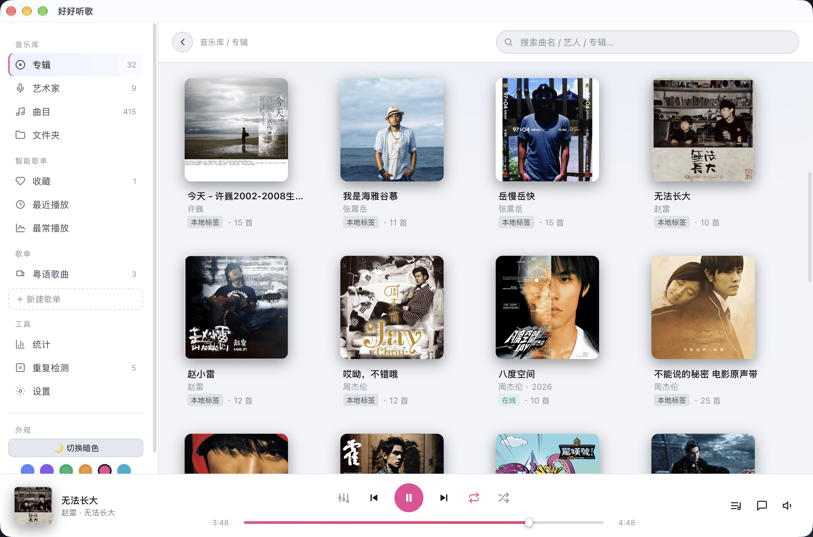
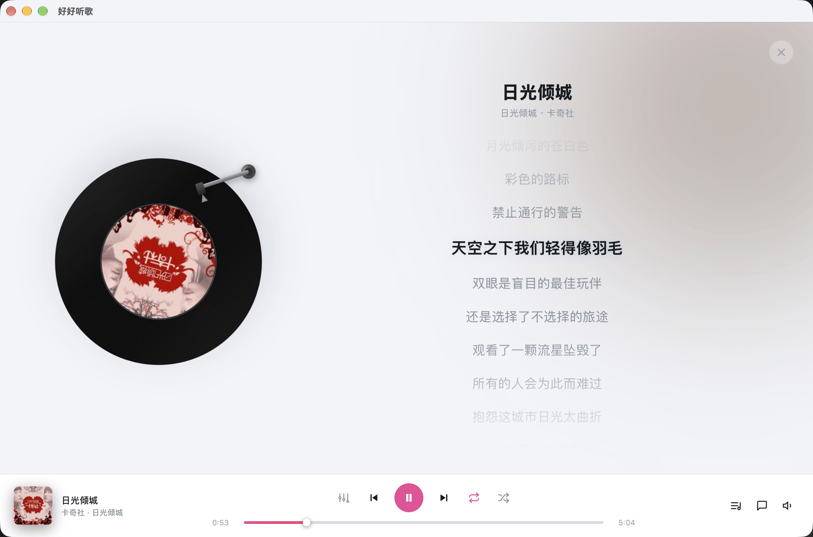
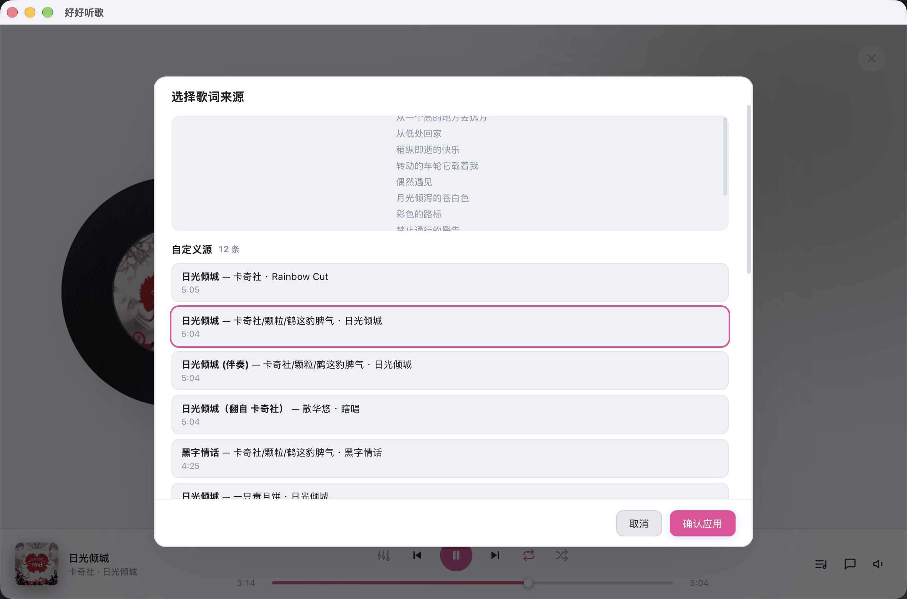

# 好好听歌

本地桌面音乐播放器。播放与曲库管理完全离线可用，联网仅用于可选的歌词 / 封面 / 元数据补全。

Tauri 2 + Rust 音频引擎，前端原生 HTML/CSS/JS（无构建链）。

## 截图

| 曲库 · 专辑视图 |
|:---:|
|  |

| 歌词 · 全屏黑胶 |
|:---:|
|  |

| 歌词 · 多源选择 |
|:---:|
|  |

> 截图中的专辑封面版权归原作者及唱片公司所有，仅作界面演示用途。

## 特性

**播放**
- 专用音频线程 + 预解码流水线，回调零负担；样本级无缝衔接（Gapless）
- 交叉淡入淡出（0–8s）、音量渐入渐出（防爆音）
- ReplayGain 响度归一：读文件标签 + 播放时自算（K 加权门控响度分析），专辑增益聚合，可写回标签
- 10 段图形 EQ + 高低音音调（RBJ biquad，实时生效）+ 频响曲线
- 播放速度 0.5–3.0x、睡眠定时、A-B 段落循环（均为功能开关，按需开启）
- 会话恢复：队列 / 曲目 / 进度 / 音量 / EQ，启动零延迟预加载
- 后台播放：关窗继续播（托盘 + 媒体键 + Now Playing 可控）

**曲库**
- 增量扫描（mtime+size 跳过）+ 文件系统监听自动入库（2s 防抖）
- 封面优先级链：手动获取 > 目录封面图（含中文命名）> 歌曲内嵌 > 歌手目录图，专辑级归一保证播放一致
- 专辑 / 艺术家（合作名自动拆分）/ 曲目（流派年代筛选 + 四键排序）/ 文件夹（双 tab）视图
- 重复曲目检测（同名 + 同主艺人 + 时长聚类）
- 搜索实时过滤，歌曲命中置顶可直接播放
- 歌单：拖拽排序、封面拼贴、M3U/M3U8 导入导出
- 多选批量操作、标签写回源文件（元数据 + ReplayGain）

**歌词**
- 三级优先级：外部 .lrc → 内嵌 → 在线缓存；行内按钮直接弹多源选择，应用后局部刷新
- 双语对照、繁转简（OpenCC 词表）、±0.25s 偏移校准（每曲独立记忆）
- 自定义源适配器协议（开放）：可接入自建服务获取歌词 / 翻译 / 封面 / 元数据

**元数据**
- 多源候选（自定义源 / iTunes / Deezer），时长匹配 + 相似度重排，行内一键应用
- MusicBrainz 置信度分级自动补全（高置信自动应用，中置信待确认）

**维护**
- 全量备份 / 恢复（zip）+ 操作级自动备份（封面 / 歌手 / 歌词 / 翻译触发，保留 10 份，记录操作对象）
- 封面缓存清理（孤儿文件回收）

## 运行

```bash
npm run dev        # 开发模式
npm run build      # 发布构建（macOS：.app + .dmg）
```

需要 Rust（stable）与 Node.js（18+）。

## 结构

```
src/              前端（原生 HTML/CSS/JS）
src-tauri/src/
  main.rs         Tauri commands / 扫描 / 备份 / 在线源
  audio.rs        音频引擎（预解码线程 + 重采样 + EQ + 无缝衔接）
  replaygain.rs   RG 2.0 分析（K 加权门控响度）与专辑聚合
  scanner.rs      扫描器（lofty 元数据 + 封面优先级链）
  db.rs           SQLite（WAL）schema / 专辑键归并 / 封面归一
  lyrics.rs       LRC 解析 / 优先级 / 在线源客户端
  provider.rs     iTunes / Deezer / MusicBrainz / 封面兜底链
vendor/rodio      上游 rodio 补丁（保持直通路径必需，勿删）
```

## 下载

见 [Releases](../../releases)——GitHub Actions 自动构建 macOS（Apple Silicon / Intel）/ Windows / Linux 包。

## 协议

MIT

